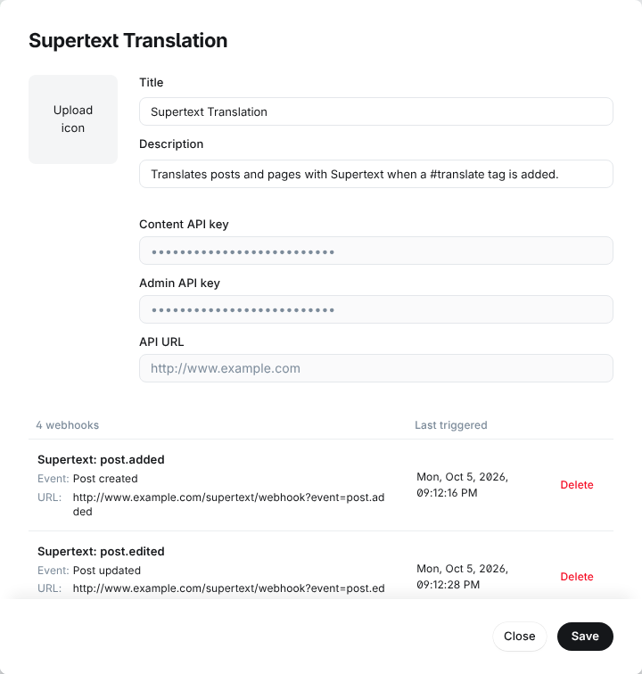
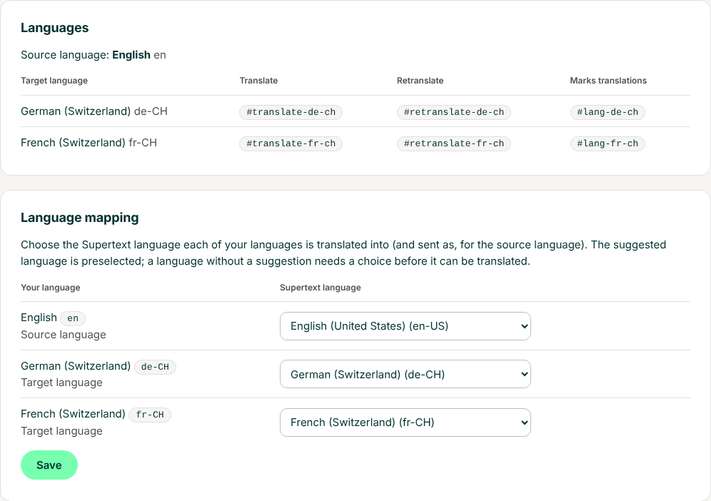
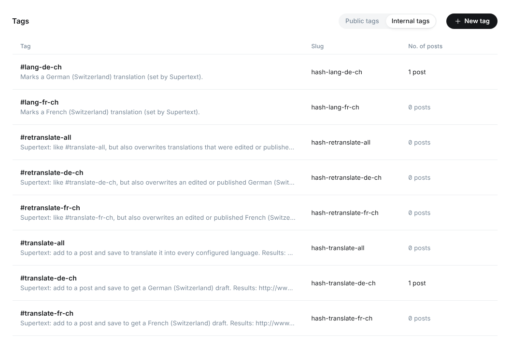
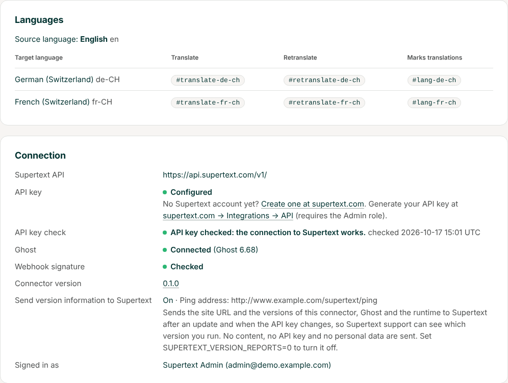

# Installation guide

For administrators. The Supertext connector is a small Node.js service next to your Ghost site. Ghost tells it through webhooks when an editor adds a `#translate-…` tag, and it writes the translation back through Ghost's Admin API.

## Requirements

- Ghost **6** (self-hosted or Ghost(Pro)). Posts must use Ghost's current (Lexical) editor, which is the default since Ghost 5.
- Node.js **20.9** or newer for the connector (or Docker).
- A Supertext account with an API key ([create an account](https://www.supertext.com/person/en/account/signin); [generate the key](https://www.supertext.com/en/integrations/api) with the Admin role; see [API key](#api-key)).
- The connector must reach `https://api.supertext.com` over HTTPS (and, for [Translation review](#translation-review), Supertext's review service).
- The connector must be reachable by Ghost over the internet, or on your Ghost site's own host name (see [Choose a setup](#choose-a-setup)).
- Ghost Administrator access, to create the integration.

## Choose a setup

Ghost refuses to send webhooks to private network addresses (`127.0.0.1`, `10.x`, `192.168.x`, Docker networks) **unless** the address is your site's own URL. That decides how you run the connector:

| Setup | When | What you get |
| --- | --- | --- |
| **A. In front of Ghost** (recommended) | You host Ghost yourself (Docker, VPS, Ghost-CLI). | The connector sits between your web server and Ghost. Webhooks go to your own site URL. Includes the staff status page at `/ghost/supertext/`. |
| **B. Standalone** | Ghost(Pro), or you can't change the web server. | The connector runs on its own public URL. Everything works except the status page; results are in the connector's log. |

### A. In front of Ghost

Run the connector with `GHOST_UPSTREAM` set to Ghost's internal address. It answers `/supertext/…` (webhooks, ping, health check, and the logo and font of the status page) and `/ghost/supertext/` itself and passes every other request to Ghost unchanged.

Either send **all** traffic to the connector (simplest), or keep your web server in front and send only these two paths to it. For example with nginx, where Ghost listens on port 2368 and the connector on 8080:

```nginx
location /supertext/        { proxy_pass http://127.0.0.1:8080; proxy_set_header Host $host; proxy_set_header X-Forwarded-Proto $scheme; }
location /ghost/supertext/  { proxy_pass http://127.0.0.1:8080; proxy_set_header Host $host; proxy_set_header X-Forwarded-Proto $scheme; }
location /                  { proxy_pass http://127.0.0.1:2368; proxy_set_header Host $host; proxy_set_header X-Forwarded-Proto $scheme; }
```

The status page lives under `/ghost/` because Ghost's login cookie is only sent to that path; the connector uses it to check that the visitor is signed in to Ghost Admin.

### B. Standalone

Run the connector anywhere with a public HTTPS address (a small container on Railway, Fly.io, Render…). Leave `GHOST_UPSTREAM` empty. Set `CONNECTOR_URL` to that address if you want Supertext to be able to check that the connector is reachable (see [Version information and the API key check](#version-information-and-the-api-key-check)).

## Install

The connector is not published to npm yet; run it from this repository.

```bash
git clone https://github.com/Supertext/Ghost-Supertext-Translation.git
cd Ghost-Supertext-Translation
npm ci && npm run build
GHOST_URL=https://blog.example.com \
GHOST_ADMIN_API_KEY=… GHOST_WEBHOOK_SECRET=… \
SUPERTEXT_API_KEY=… TARGET_LANGUAGES=de-CH,fr-CH \
GHOST_UPSTREAM=http://127.0.0.1:2368 \
npm start
```

Keep it running with your process manager (systemd, pm2, Docker). On start it logs its languages and, once it can reach Ghost, `Ghost connection OK, tags in place`.

**All-in-one Docker image:** `demo/Dockerfile` builds Ghost 6 and the connector in one container (setup A, SQLite database). It is what the demo runs on; see the [developer guide](DEVELOPER.md#demo) for its variables. For production use with MySQL, run the official Ghost image and the connector side by side instead.

## Create the integration in Ghost

1. In Ghost Admin go to **Settings → Integrations → Add custom integration**, name it `Supertext Translation`.
2. Copy the **Admin API key** into `GHOST_ADMIN_API_KEY`.
3. Add four webhooks with **Add webhook**, all with the same **Secret** (any long random string, also put it into `GHOST_WEBHOOK_SECRET`):

   | Name | Event | Target URL |
   | --- | --- | --- |
   | Supertext: post.added | Post created | `https://<your site or connector>/supertext/webhook?event=post.added` |
   | Supertext: post.edited | Post updated | `…/supertext/webhook?event=post.edited` |
   | Supertext: page.added | Page created | `…/supertext/webhook?event=page.added` |
   | Supertext: page.edited | Page updated | `…/supertext/webhook?event=page.edited` |

   The `?event=` part is required: Ghost's webhook body doesn't say which event it is.



The demo creates this integration automatically.

## API key

1. **No Supertext account yet?** [Log in or create a Supertext account](https://www.supertext.com/person/en/account/signin) with your email address.
2. **Generate your API key** at [supertext.com → Integrations → API](https://www.supertext.com/en/integrations/api). This page requires the **Admin** role in your Supertext account; if you don't have it, ask an administrator of your Supertext account.
3. Set the key as `SUPERTEXT_API_KEY`.

You can paste it with or without the `Supertext-Auth-Key ` prefix Supertext shows; the connector sends it correctly either way. Never commit it to a repository.

Without a key the connector still starts, but every request fails with "No Supertext API key is configured", the startup log says `SUPERTEXT_API_KEY is not set`, and the status page shows the key as **Missing** together with the links above.

## Language setup

Ghost has no built-in multilingual content. The connector models languages the way most multilingual Ghost sites do: **one post per language, marked with an internal tag**.

- `SOURCE_LANGUAGE` is the language your editors write in (default `en`).
- `TARGET_LANGUAGES` lists the languages to translate into, separated by commas (default `de-CH,fr-CH`). The codes also name the tags (`de-CH` → `#translate-de-ch`).

Each language needs a Supertext language. Supertext accepts exactly these target codes (from its `features` list, October 2026):

| Language | Supertext codes |
| --- | --- |
| German, English, French, Italian, Portuguese | `de-DE`, `de-CH`, `de-AT`, `en-US`, `en-GB`, `fr-FR`, `fr-CH`, `it-IT`, `it-CH`, `pt-PT`, `pt-BR` |
| Chinese, Serbian | `zh-Hans`, `zh-Hant`, `sr-Latn`, `sr-Cyrl` |
| Swiss German | `gsw-u-sd-chzh` (Zurich), `gsw-u-sd-chbe` (Bern) |
| All others, without region | `bg`, `cs`, `da`, `el`, `es`, `fi`, `hr`, `hu`, `ja`, `ko`, `nb`, `nl`, `pl`, `rm`, `ru`, `sk`, `sl`, `sq`, `sv`, `tr` |

Which Supertext language each of your languages is sent as is decided in this order:

1. **The mapping**: `SUPERTEXT_LANGUAGE_MAP` if it names the language, else the choice on the status page (*Language mapping*, see below).
2. Else a code that **is** one of the codes above (apart from upper/lower case and `_`/`-`) is sent as it is: `de-CH`, `fr_ch`, `es`.
3. Else the **default**, only where it is obvious:

   | Your code | Sent as |
   | --- | --- |
   | `de`, `en`, `fr`, `it`, `pt` | `de-DE`, `en-US`, `fr-FR`, `it-IT`, `pt-PT` |
   | `zh`, `zh-CN`, `zh-SG` | `zh-Hans` |
   | `zh-TW`, `zh-HK`, `zh-MO` | `zh-Hant` |
   | `sr` | `sr-Latn` |
   | a region of a language Supertext offers without region (`es-ES`, `nl-BE`, `sl-SI`) | the language without region (`es`, `nl`, `sl`) |

4. Else nothing is guessed: the language has **no Supertext language yet** and nothing is sent for it (for example `de-LI`, `en-IE`, `gsw`, `sr-RS`). The startup log names these languages, and the status page marks them **No Supertext language**.

The tags always keep your code (`#translate-de`); Supertext gets the mapped one. The same mapping applies to `SOURCE_LANGUAGE`, which is sent without region (`en` mapped to `en-GB` → `en`).

#### Language mapping on the status page

The status page at `/ghost/supertext/` ([setup A](#a-in-front-of-ghost)) has a **Language mapping** section with one drop-down list per language, the source language first. Each list offers Supertext's target languages as *Name (code)*, in the page's language. It shows the saved choice, else the default from the table above, else *— choose —*. Choose a language and click **Save**; only Supertext's own codes are accepted. Changes apply right away, without a restart.



Next to each **target** language is a **Translation review** checkbox (off by default): see [Translation review](#translation-review). It is saved with the same **Save** button.

- Every signed-in staff user sees the section; only Ghost **Owners and Administrators** can save it.
- The choices are kept in `supertext-settings.json` next to `STATE_FILE` (or in `SUPERTEXT_SETTINGS_FILE`). Without either, they are kept in memory until the next restart, and the section says so.
- `SUPERTEXT_LANGUAGE_MAP` stays available for automated setups and **wins**: a language it names is shown read-only with *Set by SUPERTEXT_LANGUAGE_MAP*. Format: `code=Supertext code`, separated by commas, e.g. `SUPERTEXT_LANGUAGE_MAP=de-LI=de-CH,zh=zh-Hant` (JSON such as `{"de":"de-CH"}` works too).
- Setup B (standalone) has no status page: there, use `SUPERTEXT_LANGUAGE_MAP` for every language that needs a different code than its default.

Formal/informal (`SUPERTEXT_POLITENESS`) isn't offered for English, Swiss German, Romansh, Albanian and Serbian. Set for one of these languages (`en-US=more`), its translations fail with *Supertext offers no formal or informal tone for this language* until you remove the entry; set for all languages (`more`), these languages are translated with the default tone. The status page shows both cases.

Existing sites: an existing `SUPERTEXT_LANGUAGE_MAP` keeps working unchanged (and still wins over the status page). A bare `de`, `fr` or `en` that wasn't mapped is now sent as `de-DE`, `fr-FR`, `en-US` instead of failing; choose another variant on the status page if you prefer.

For each target language the connector creates three internal tags on startup (`de-CH` shown):

| Tag | Purpose |
| --- | --- |
| `#translate-de-ch` | Editors add it to request a translation. |
| `#retranslate-de-ch` | Same, but also replaces an edited or published translation. |
| `#lang-de-ch` | Set by the connector on every German (Switzerland) translation. |

plus `#translate-all` and `#retranslate-all`. You find them under **Tags → Internal tags**:



The status page's **Connection** section shows the rest of the configuration:



Its **Connection** section also shows the **Connector version** (from the connector's `package.json`). Ghost has no plugin list, so this is where you check which version you run, for example before and after an update; a release version links to its release notes on GitHub. The startup log shows it too (`[supertext] Connector 0.1.0 listening on …`).

### Language sections on the site

To give each language its own section on the public site, upload a `routes.yaml` under **Settings → Labs → Routes** that puts translations into their own collection. The demo uses:

```yaml
routes:

collections:
  /de-ch/:
    permalink: /de-ch/{slug}/
    template: index
    filter: tag:hash-lang-de-ch
  /fr-ch/:
    permalink: /fr-ch/{slug}/
    template: index
    filter: tag:hash-lang-fr-ch
  /:
    permalink: /{slug}/
    template: index
    filter: tag:-hash-lang-de-ch+tag:-hash-lang-fr-ch

taxonomies:
  tag: /tag/{slug}/
  author: /author/{slug}/
```

Language collections must come before `/`. Then add menu links to `/de-ch/` and `/fr-ch/` under **Settings → Navigation**.

Ghost's **Publication language** (Settings → General) is one value for the whole site, so the `lang` attribute of every page stays the source language unless your theme sets it from the `#lang-…` tag.

## Translation review

With **Translation review**, people check the translations on the website itself and correct them there: customers or Supertext linguists open the original and the translated page side by side in Chrome with the *Supertext Localization Review* extension and fix texts in a side panel. Their corrections come back into Ghost.

Turn it on per language on the status page ([setup A](#a-in-front-of-ghost)): **`/ghost/supertext/` → *Language mapping* → tick *Translation review* next to the language translated into → Save** (Ghost Owner or Administrator). Untick it to turn it off again; nothing else changes.

- Translations into that language then go through Supertext's review service instead of directly to Supertext. It answers exactly like Supertext and passes everything on with your API key, so billing, languages, formal/informal and error messages stay the same.
- The review service keeps every translation of your account. A text it has translated before gets the same translation again (without a new Supertext call), and once a reviewer has corrected it, the corrected text.
- **Corrections arrive with the next translation:** after a review, translate the posts or pages again (`#retranslate-…` replaces a translation that was edited or published; `#translate-…` updates an untouched draft) to write the corrections into Ghost. As always, translating again overwrites manual changes in the translated texts.
- Reviewers get a review link for your site from Supertext; nothing to set up in Ghost.
- The review service works with keys of the **live** Supertext API. With `SUPERTEXT_API_URL` pointing at staging or testing, leave review off.
- *Export for translation* and *Import translation* don't use the review service. The automatic API key check and the version reports still go directly to Supertext.
- `SUPERTEXT_REVIEW_URL` sets another review service (only when Supertext gives you another address); set it empty (or `off`) to turn review off for every language: the checkboxes are then disabled. The status page's **Connection** section shows the review service in use.
- Setup B (standalone) has no status page and therefore no Translation review.

## Translation files

The status page links to **Translation files** (`/ghost/supertext/files`, setup A only): *Export for translation* (XLIFF 1.2 or HTML) and *Import translation* ([user guide](USER_GUIDE.md#translate-with-a-file-xliff-or-html)). Nothing to configure, and no Supertext API key needed (no API call). It needs a signed-in Ghost staff session with the **Owner, Administrator or Editor** role (they may edit every post; the connector writes with the integration's key), the page's CSRF token and a same-origin request. Uploads are limited to **10 MB** (refused before reading), parsed in memory and never stored. Imported translations are saved as drafts like tag translations, with the same overwrite rules.

## All settings

| Variable | Default | Meaning |
| --- | --- | --- |
| `GHOST_URL` | `url`, else `https://$RAILWAY_PUBLIC_DOMAIN` | Public URL of the Ghost site. Required. |
| `GHOST_ADMIN_API_KEY` | — | Admin API key of the custom integration (`<id>:<secret>`). Required (or via `GHOST_SETTINGS_FILE`). |
| `GHOST_WEBHOOK_SECRET` | — | Secret of the webhooks. When set, unsigned or wrongly signed webhooks are rejected. Strongly recommended. |
| `GHOST_SETTINGS_FILE` | — | JSON file with `adminKey` and `webhookSecret`, used when the variables above are empty; re-read when it changes (the demo writes it). |
| `GHOST_UPSTREAM` | — | Setup A: Ghost's internal address, e.g. `http://127.0.0.1:2368`. Enables the proxy and the status page. |
| `SUPERTEXT_API_KEY` | — | Your Supertext API key, generated at [supertext.com → Integrations → API](https://www.supertext.com/en/integrations/api) (Admin role). |
| `SUPERTEXT_API_URL` | `https://api.supertext.com/v1/` | Supertext API endpoint. For [Translation review](#translation-review) use the status page's checkboxes instead. |
| `SUPERTEXT_REVIEW_URL` | Supertext's review service (`https://localizationreview-production.up.railway.app/v1/`) | Address of the review service for languages with *Translation review* on. Empty (or `off`, `0`, `false`, `no`) turns review off for every language. Only change it when Supertext gives you another address. |
| `SOURCE_LANGUAGE` | `en` | Language of the originals. Sent to Supertext without region (`en-GB` → `en`). |
| `TARGET_LANGUAGES` | `de-CH,fr-CH` | Target languages, comma-separated. Each is a Supertext code, has a default (`de` → `de-DE`) or is mapped on the status page or in `SUPERTEXT_LANGUAGE_MAP` (see [Language setup](#language-setup)). |
| `SUPERTEXT_LANGUAGE_MAP` | — | Optional override of the status page's *Language mapping*: your code → Supertext code, e.g. `de=de-CH,zh=zh-Hant` (or JSON `{"de":"de-CH"}`). The languages it names can't be changed on the status page. Needed in setup B for codes without a default. |
| `SUPERTEXT_SETTINGS_FILE` | `supertext-settings.json` next to `STATE_FILE` | JSON file for the language mapping and *Translation review* chosen on the status page (`languageCodes`, `review`). Without it and without `STATE_FILE` the mapping is kept in memory only. |
| `SUPERTEXT_POLITENESS` | `default` | Formal or informal address: `more` (formal, e.g. *Sie*/*vous*), `less` or `default`, for all languages, or per language: `de-CH=more,fr-CH=less`. |
| `PORT` / `HOST` | `8080` / `0.0.0.0` | Where the connector listens. |
| `JOBS_FILE` | — | JSON file to keep the status page's history across restarts. |
| `SUPERTEXT_VERSION_REPORTS` | on | *Send version information to Supertext* (see below). `0` (or `false`, `off`, `no`) turns it off. |
| `CONNECTOR_URL` | — | Setup B: the connector's public URL, for the ping address (`<CONNECTOR_URL>/supertext/ping`). In setup A the site's own URL is used. |
| `STATE_FILE` | — | JSON file for what was last reported to Supertext and the latest API key check. Without it this is kept in memory, so after each restart the key is checked again and the installation is reported as new. |
| `UI_LANGUAGE` | `auto` | Language of the status page and of the tag descriptions: `en`, `de`, `fr`, `it`, or `auto` (see *Interface languages*). |

Changing `TARGET_LANGUAGES`, `SUPERTEXT_LANGUAGE_MAP` or `SUPERTEXT_REVIEW_URL` needs a restart; the status page's *Language mapping* and *Translation review* apply right away.

### Version information and the API key check

**Send version information to Supertext** is on by default. The connector then sends the site URL and the versions of this connector, Ghost and Node.js to Supertext when it starts after an update and when the API key changes, so Supertext support can see which version you run. A report contains exactly: the site URL (`GHOST_URL`), the connector's name and version, the Ghost and Node.js versions, the Supertext SDK version, whether a key is set, the result of the API key check below (status, time, HTTP status, Supertext's error code) and the address of the ping endpoint. **No content, no API key and no personal data are sent.** Reports go from the connector, never from the browser; a report that fails is not retried for an hour and never slows down or breaks a translation. Set `SUPERTEXT_VERSION_REPORTS=0` and restart the connector to turn it off: nothing is sent at all then, and the ping endpoint answers 404. The status page shows whether it is on.

**The API key check** runs whether or not version information is sent: when the connector starts with a key it hasn't checked yet, when it runs its code (status page, a translation) and the key in `SUPERTEXT_API_KEY` changed (compared by a fingerprint kept locally, never the key itself), and when Supertext rejects the key during a translation. It's Supertext's cost-free `features` call; nothing is translated or billed. The status page shows the latest result with its time: *the connection works*, *Supertext rejected the API key* (with the links to create an account and generate a key), *no API key is set*, *Supertext can't be reached* or *Supertext answered with an error*.

**The ping endpoint** `GET /supertext/ping?challenge=…` on the connector is public (no login, never cached) and answers only `{"ok":true,"plugin":"Ghost-Supertext-Translation","challenge":"…"}`, so Supertext can see that the installation is reachable from the internet. It returns nothing else: no versions, no settings, no data. Its address in the reports is `<site URL's scheme and host>/supertext/ping` in setup A (the path your web server already sends to the connector) and `<CONNECTOR_URL>/supertext/ping` in setup B. Supertext only calls addresses on the site's own host or a subdomain of it, so in setup B give the connector a subdomain of your site (e.g. `supertext.blog.example.com`) if you want the check; without `CONNECTOR_URL` no ping address is sent.

The connector keeps this state (what was reported last, the latest key check) in `STATE_FILE`; the demo uses `content/data/supertext-state.json`. New tags are created on start; tags of removed languages are left in Ghost.

## Interface languages

The status page and its messages are available in English, German, French and Italian. Ghost Admin has no per-user interface language that the connector could read, so the page follows the browser's language (`Accept-Language`: a French browser gets French); other languages fall back to English. Set `UI_LANGUAGE=de` (or `en`, `fr`, `it`) to use one language for everyone.

The descriptions of the internal tags in *Ghost Admin → Tags* are written in `UI_LANGUAGE` when it names a language, otherwise in English. They are set when the connector creates a tag; to change the language of existing tags, delete those tags in Ghost Admin and restart the connector (they are created again). The tag **names** (`#translate-de-ch` …) are never translated. The log is always English.

## Update

`git pull && npm ci && npm run build`, then restart. Check the [changelog](../CHANGELOG.md) first.

## Uninstall

1. Delete the **Supertext Translation** integration in Ghost (this removes its webhooks and key).
2. Stop the connector and, in setup A, point your web server back at Ghost.
3. Optional: delete the `#translate-…`, `#retranslate-…` tags. Keep the `#lang-…` tags if you use them in `routes.yaml`.

Translations stay normal Ghost posts. Each carries an invisible HTML comment in its **Code injection → Site header** (`<!-- supertext:source=… -->`) that links it to its original; you can leave or remove it.

## Troubleshooting

| Symptom | Cause and fix |
| --- | --- |
| Nothing happens after adding a tag | Check the connector log for `#… posts … → de-CH`. If there's nothing, Ghost didn't deliver the webhook: look in Ghost's log for `WEBHOOK_DELIVERY_FAILURE`. |
| Ghost log: `URL resolves to a non-permitted private IP block` | The webhook points at a private address. Use the site's own URL (setup A) or a public connector URL (setup B). |
| Ghost log: `URL invalid` | Ghost rejects host names without a domain, such as `localhost`. Use a real host name. |
| Connector log: `Rejected a webhook with a missing or wrong signature` | `GHOST_WEBHOOK_SECRET` doesn't match the secret of the webhooks. |
| Connector log keeps saying `Waiting for Ghost` | The Admin API key is missing or wrong, or Ghost isn't reachable at `GHOST_UPSTREAM`/`GHOST_URL`. |
| Status page sends you to the Ghost sign-in | You're not signed in to Ghost Admin in this browser, or the page isn't served under `/ghost/supertext/` on the site's own host. |
| Status page: "only available when the connector runs in front of Ghost" | Setup B; use the connector log instead. |
| "Authentication failure. Please check your Supertext API key. …" | Wrong or expired `SUPERTEXT_API_KEY`. Generate a new one at [supertext.com → Integrations → API](https://www.supertext.com/en/integrations/api) (Admin role). |
| "Supertext does not support this language pair (en → xx-YY)" | A code in `SUPERTEXT_LANGUAGE_MAP` Supertext doesn't offer (e.g. `es-ES` instead of `es`), or the target is the same language as the source; fix the entry, or remove it and choose the language under *Language mapping* on the status page. The message shows the codes that were sent. |
| "The language … has no Supertext language yet" / **No Supertext language** on the status page | The code in `TARGET_LANGUAGES` or `SOURCE_LANGUAGE` is no Supertext code and has no default (e.g. `de-LI`, `gsw`): choose its Supertext language under *Language mapping* on the status page (Ghost Owner or Administrator), or add it to `SUPERTEXT_LANGUAGE_MAP` and restart (see [Language setup](#language-setup)). |
| *Language mapping*: "Kept in memory only" or "only until the next restart" | Neither `STATE_FILE` nor `SUPERTEXT_SETTINGS_FILE` is set, or the file can't be written: set one to a writable path (the demo uses its volume). |
| *Language mapping*: "The form has expired" | The page was open across a restart of the connector or you signed in again: reload the status page and save again. |
| "Supertext offers no formal or informal tone for this language" | `SUPERTEXT_POLITENESS` sets `more`/`less` for a language without it (English, Swiss German, Romansh, Albanian, Serbian); remove that entry and restart. |
| "Supertext rejected the API key" on the status page | The key is wrong or revoked. Check that the whole key is in `SUPERTEXT_API_KEY`, or generate a new one at [supertext.com → Integrations → API](https://www.supertext.com/en/integrations/api) (Admin role). No Supertext account yet? [Create one](https://www.supertext.com/person/en/account/signin). Restart the connector; it checks the new key. |
| "The API key couldn't be checked because Supertext can't be reached" | The connector can't reach `api.supertext.com` (firewall, proxy, DNS). Translations need the same connection. |
| "Authentication failure" only for languages with *Translation review* | The review service only works with keys of the live Supertext API: with `SUPERTEXT_API_URL` on staging/testing leave review off. |
| Reviewers' corrections don't show up in Ghost | They arrive with the next translation: translate the posts into that language again (`#retranslate-…` if the translation was edited or published). Check that *Translation review* is ticked for that language on the status page. |
| *Translation review* checkboxes are disabled | `SUPERTEXT_REVIEW_URL` is empty or `off` (review off everywhere), or you're not a Ghost Owner or Administrator. |
| "Too many requests" | Supertext's per-second limit. The connector retries four times; translating fewer languages at once helps. |
| "No content in Ghost's current editor format" | The post was written in Ghost's legacy editor; open and save it once to convert it. |
