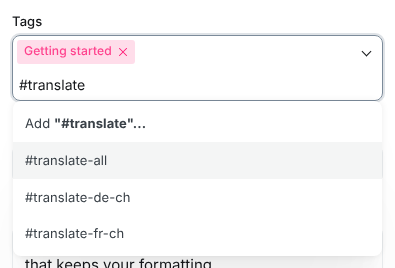
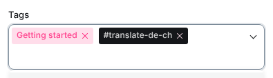
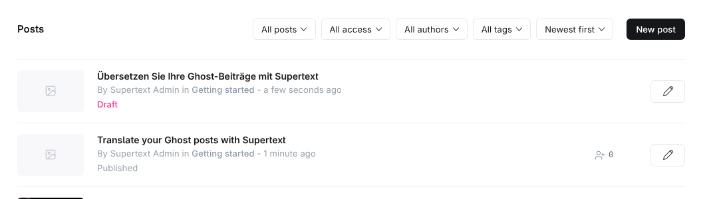
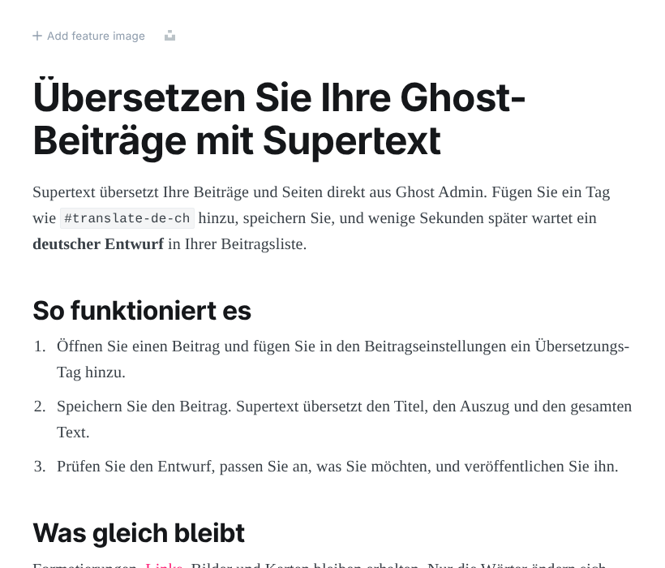
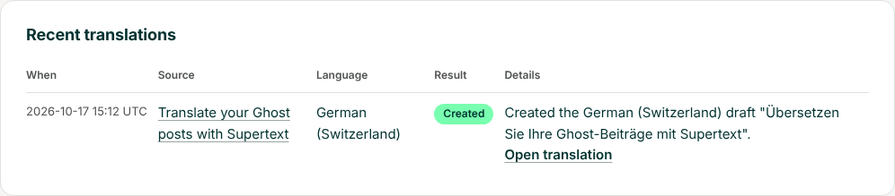
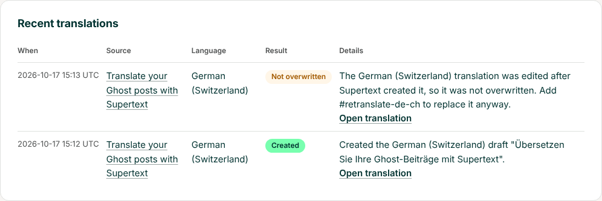

# User guide

For editors who write in Ghost Admin. Supertext translates a post or page when you add a tag to it. The translation arrives as a **draft** next to the original, so you can review it before anyone sees it.

All examples use the demo's languages, German (Switzerland) and French (Switzerland). Your site may offer other languages; the tags follow the same pattern.

## Translate a post or page

1. Open the post (or page) in Ghost Admin.
2. Open **Post settings** with the panel icon at the top right.
3. Click into **Tags** and type `#translate`. Pick the language you want:

   

   | Tag | Result |
   | --- | --- |
   | `#translate-de-ch` | a German (Switzerland) draft |
   | `#translate-fr-ch` | a French (Switzerland) draft |
   | `#translate-all` | a draft in every language your site offers |

4. That's it: Ghost saves tag changes right away, also on published posts.

   

A few seconds later the translation shows up at the top of your posts list as a draft, with the translated title:

The tag stays on your original post. That is fine: it only does something at the moment it is added.

## Review and publish

Open the draft like any other post. Everything is translated: the title, the text, headings, lists, quotes, image captions and alt texts, callouts, buttons and other cards, the excerpt and the SEO and social media texts. Bold, italic, links and the layout are the same as in the original.

Correct whatever you like, then **Publish** as usual. If your site is set up for it (the demo is), translations appear on the public site in their own section, for example `/de-ch/` for German (Switzerland), and the menu links to them.

What the translation keeps from the original: authors, public tags, feature image, post access (public, members, paid) and featured flag. It gets the tag `#lang-de-ch` (or the tag of its language), which is what puts it in the right section of the site. **Don't remove that tag.**

## See what happened

Logged-in staff can open the **Supertext status page** at `/ghost/supertext/` on your site (for example `https://blog.example.com/ghost/supertext/`). The link is also in the description of every `#translate` tag under **Tags → Internal tags**. It lists the latest requests, their result and a link to each translation:

The page refreshes itself while a translation is running. Further down it shows which Supertext language each of your languages is translated into (*Language mapping*); only Ghost Owners and Administrators can change it.

## Translate with a file (XLIFF or HTML)

Instead of a tag, you can download a post's or page's text as a file, have it translated anywhere (a translation tool such as Trados, memoQ or Phrase, a translator, Supertext's web app) and import the translated file again. Open **Translation files** on the status page (`/ghost/supertext/files`, linked under *Translation files*). Ghost Editors, Administrators and Owners can use it (Authors and Contributors can't: the connector writes with the integration's rights).

### Export for translation

1. Under **Export for translation**, choose the **Post or page** (translations themselves aren't listed).
2. Choose the **File format**:
   - **XLIFF 1.2 (for translation tools)**: the standard format of translation tools, and the better choice for them. Formatting and links appear as protected tags. One file can hold several languages.
   - **HTML (one language per file)**: for Supertext's web app or anyone who translates HTML. Tick exactly one language.
3. Tick the **Target languages** and click **Download file** (`ghost-<post id>-<language>.xlf`, or `ghost-<post id>.xlf` for several languages).

The file contains exactly the text a tag translation would send (see [What is not translated](#what-is-not-translated)). Whoever translates an **HTML** file must leave its head (the `supertext:` lines) and the `data-st-id` attributes alone. An HTML file can't mark text as untranslated: imported unchanged, it writes the source text into the translation.

### Import translation

1. Under **Import translation**, choose the **Translated file (XLIFF or HTML)** (at most 10 MB).
2. Optionally tick **Also import texts whose source changed since the export** (skipped by default, because the translation may no longer fit) and **Also replace translations that were edited or published** (like the `#retranslate-…` tags).
3. Click **Import translation**.

The translation is saved exactly like one from a tag: a new **draft** with the language's `#lang-…` tag, linked to the original, or the existing draft if nobody edited it; edited or published translations are only replaced with the second option. Texts that aren't imported stay in the source language. The page then shows a summary per post and language, and the import also appears under *Recent translations*:

| Line | Meaning |
| --- | --- |
| *Imported: n* | Texts written into the translation. |
| *Skipped, source changed since the export: n* | The original's text was edited after the export. Tick the option to import them anyway, or export again. |
| *Not translated in the file: n* | The file has no translation for these texts (XLIFF). |
| *Formatting changed, not imported: n* | The translation broke, removed or added formatting the original doesn't have. Fix it in the translation tool. |
| *Not in the file: n* | Text added after the export. Export again. |

| Message | Meaning |
| --- | --- |
| *This file isn't a valid XLIFF or HTML translation file.* | The file is damaged or not XLIFF/HTML. |
| *This file wasn't exported by the Supertext connector, or its header was removed.* | Use a file from *Export for translation*; for HTML keep its head. |
| *The file is too large (at most 10 MB).* | Export fewer languages per file. |
| *This file belongs to another system (…).* | It comes from another Supertext plugin (another CMS). |
| *The post or page this file was exported from no longer exists.* | It was deleted, or the file's reference is damaged. |
| *The site has no language ….* | The connector isn't configured for that language (any more). |
| *Not overwritten* | As with tags: the translation was edited or published. Tick *Also replace translations that were edited or published*. |

## Translate again after changing the original

If you change the original and want the translation to follow, remove the `#translate-…` tag, then add it again.

- If the translation is still an **unchanged draft**, it is updated in place.
- If someone **edited** the translation, or it is **published**, it is left alone so nobody's work is lost. The status page shows *Not overwritten*:

  

  To replace it anyway, add `#retranslate-de-ch` (or `#retranslate-all`) to the original. This overwrites the translation's text with a fresh translation. A published translation stays published, so check it right after.

## What is not translated

- Tags, authors' names and the post URL (Ghost creates the URL from the translated title once; it is not changed later).
- HTML, Markdown and code cards, embedded content (videos, social posts), and bookmark previews (they show the linked site's own text).
- Email-only content and the newsletter subject of posts that were already sent.
- Inline code (text formatted as code) stays as written.

## Messages on the status page

The status page follows your browser's language (English, German, French or Italian), unless your administrator set one language for everyone; the tag names stay the same in every language.

| Result | Meaning | What to do |
| --- | --- | --- |
| Created | A new draft was made. | Review and publish it. |
| Updated | The unchanged draft was replaced with a fresh translation. | Review it. |
| Not overwritten | The translation was edited or published, so it was kept. | Add `#retranslate-…` if you want to replace it. |
| Skipped | You added the tag to a translation, not to an original. | Add the tag to the original post. |
| Failed: "… no content in Ghost's current editor format" | The post was written in Ghost's old editor. | Open it, make any small change, save, then add the tag again. |
| Failed: "Authentication failure …" or "No Supertext API key …" | The site's Supertext settings are wrong. | Tell your administrator. They can generate a key at supertext.com → Integrations → API (see the [installation guide](INSTALLATION.md#api-key)). |
| Failed: "Supertext does not support this language pair (en → …)" | Supertext can't translate between these two languages, or the language mapping is wrong. | Tell your administrator. |
| Failed: "The language … has no Supertext language yet" | Your administrator hasn't told the connector which Supertext language to use for it. Nothing was sent to Supertext. | Ask your administrator to choose its Supertext language on the status page (*Language mapping*); the other languages are translated. |
| Failed: "Supertext offers no formal or informal tone for this language" | The tone setting for that language isn't available at Supertext (English, Swiss German, Romansh, Albanian, Serbian). | Ask your administrator to set it to the default tone. |
| Failed: "… translation limit is exceeded" | Your Supertext subscription is used up. | Tell your administrator. |
| Failed: "Interrupted by a restart" | The server restarted while translating. | Remove the tag, then add it again. |
| "… text part(s) came back empty" | A few pieces stayed in the original language. | Translate those pieces by hand in the draft. |
